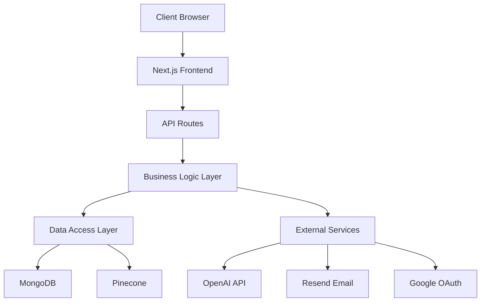
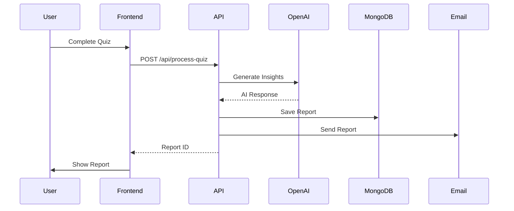

# FutureU Architecture Documentation

## Table of Contents
1. [Overview](#overview)
2. [Technology Stack](#technology-stack)
3. [Project Structure](#project-structure)
4. [Core Architecture](#core-architecture)
5. [Frontend Architecture](#frontend-architecture)
6. [Backend Architecture](#backend-architecture)
7. [Data Flow](#data-flow)
8. [Key Features](#key-features)
9. [Security](#security)
10. [Performance Optimizations](#performance-optimizations)
11. [Development Guidelines](#development-guidelines)

## Overview

FutureU is an AI-powered career planning platform that helps users map out their professional future through interactive quizzes and personalized insights. The application uses Next.js 14 with App Router, MongoDB for data persistence, and integrates with OpenAI for generating career insights.

### Key Features
- 🎯 Interactive career assessment quizzes
- 🤖 AI-powered career insights and recommendations
- 📊 Personalized 5-year career roadmaps
- 💾 Progress persistence and resume capability
- 📧 Email delivery of career reports
- 🔐 Secure authentication with Google OAuth

## Technology Stack

### Frontend
- **Framework**: Next.js 14 (App Router)
- **Language**: TypeScript
- **Styling**: Tailwind CSS
- **UI Components**: Custom components built with Radix UI primitives
- **Animations**: Framer Motion
- **State Management**: React Context API
- **Authentication**: NextAuth.js

### Backend
- **Runtime**: Node.js
- **API Routes**: Next.js API Routes
- **Database**: MongoDB with Mongoose ODM
- **Authentication**: NextAuth with Google OAuth
- **AI Integration**: OpenAI GPT-4
- **Vector Database**: Pinecone
- **Email Service**: Resend
- **Session Storage**: Redis (via ioredis)

### Infrastructure
- **Hosting**: Vercel (assumed)
- **Database**: MongoDB Atlas
- **Vector Search**: Pinecone Cloud
- **Analytics**: Google Analytics & Amplitude

## Project Structure

```
future-u/
├── app/                      # Next.js App Router pages
│   ├── api/                  # API routes
│   │   ├── auth/            # Authentication endpoints
│   │   ├── process-quiz/    # Quiz processing logic
│   │   ├── quiz-progress/   # Quiz state persistence
│   │   └── ...
│   ├── quiz/                # Quiz pages
│   │   └── [type]/         # Dynamic quiz routes
│   ├── report/              # Report viewing pages
│   ├── auth/                # Authentication pages
│   └── layout.tsx           # Root layout
├── components/              # React components
│   ├── ui/                 # Base UI components
│   └── quiz/               # Quiz-specific components
├── lib/                    # Utility functions and configurations
│   ├── quiz-context.tsx    # Quiz state management
│   ├── quiz-data.ts       # Quiz configurations
│   ├── mongodb.ts         # Database connection
│   └── auth.ts            # NextAuth configuration
├── models/                 # MongoDB schemas
│   ├── User.ts
│   ├── Report.ts
│   ├── QuizProgress.ts
│   └── QuizTemp.ts
├── public/                 # Static assets
└── scripts/               # Utility scripts
```

## Core Architecture

### 1. Application Layer Architecture



### 2. Component Architecture

The application follows a component-based architecture with clear separation of concerns:

- **Pages**: Route-specific components that handle data fetching and page-level state
- **Components**: Reusable UI components organized by feature
- **Hooks**: Custom React hooks for shared logic
- **Context**: Global state management for quiz progress and user session

### 3. State Management

```typescript
// Quiz Context Structure
interface QuizContextType {
  // Current quiz state
  currentQuizType: string | null
  currentQuestionIndex: number
  answers: Record<number, string>
  
  // Progress tracking
  quizProgress: QuizProgress | null
  completedSections: number[]
  
  // Actions
  startQuiz: (quizType: string) => void
  saveAnswer: (questionId: number, answer: string) => void
  navigateToQuestion: (index: number) => void
  markSectionComplete: (sectionId: number) => void
}
```

## Frontend Architecture

### Component Hierarchy

```
<QuizProvider>
  <QuizPage>
    <QuizProgress />
    <AnimatePresence>
      <QuizWelcome /> | <QuizQuestion /> | <QuizSectionTransition />
    </AnimatePresence>
  </QuizPage>
</QuizProvider>
```

### Key Components

1. **QuizProvider** (`/lib/quiz-context.tsx`)
   - Global state management for quiz progress
   - LocalStorage persistence
   - Auto-save functionality

2. **QuizQuestion** (`/components/quiz/QuizQuestion.tsx`)
   - Individual question display
   - Answer validation
   - Keyboard navigation support

3. **QuizProgress** (`/components/quiz/QuizProgress.tsx`)
   - Visual progress indicators
   - Section tracking
   - Time estimation

4. **QuizSectionTransition** (`/components/quiz/QuizSectionTransition.tsx`)
   - Celebratory transitions between sections
   - Progress milestones

### Animation System

Using Framer Motion for consistent animations:

```typescript
// Example animation variants
const questionVariants = {
  initial: { x: 300, opacity: 0 },
  animate: { x: 0, opacity: 1 },
  exit: { x: -300, opacity: 0 }
}
```

## Backend Architecture

### API Routes Structure

1. **Authentication** (`/api/auth/[...nextauth]`)
   - Google OAuth integration
   - Session management
   - User creation/update

2. **Quiz Processing** (`/api/process-quiz`)
   - Receives quiz answers
   - Generates AI insights
   - Creates career reports
   - Sends email notifications

3. **Quiz Progress** (`/api/quiz-progress`)
   - CRUD operations for quiz state
   - Auto-save endpoint
   - Progress retrieval

### Data Models

#### User Model
```typescript
{
  email: string
  name?: string
  googleId?: string
  image?: string
  credits: number
  createdAt: Date
  lastQuizDate?: Date
}
```

#### Report Model
```typescript
{
  userId: string
  type: 'quickie' | 'medium' | 'deep-dive'
  content: {
    summary: string
    strengths: string[]
    challenges: string[]
    opportunities: string[]
    nextSteps: string[]
    careerPaths: CareerPath[]
  }
  quiz: {
    type: string
    answers: Record<number, string>
    completedAt: Date
  }
  emailSent: boolean
  createdAt: Date
}
```

#### QuizProgress Model
```typescript
{
  userId: string
  quizType: string
  currentQuestionIndex: number
  answers: Record<number, string>
  completedSections: number[]
  startedAt: Date
  lastUpdatedAt: Date
  status: 'in_progress' | 'completed' | 'abandoned'
}
```

## Data Flow

### Quiz Completion Flow



### Progress Persistence Flow

1. **Auto-save** (every 2 seconds after changes)
2. **Periodic save** (every 30 seconds)
3. **On-demand save** (navigation events)
4. **LocalStorage** (immediate, client-side)
5. **MongoDB** (authenticated users only)

## Key Features

### 1. Quiz System

- **Multiple Quiz Types**:
  - Test Quiz (3 questions)
  - Quickie (10 questions)
  - Medium (40 questions with sections)
  - Deep Dive (100 questions with 5 sections)

- **Features**:
  - Progress persistence
  - Section-based organization
  - Real-time validation
  - Keyboard navigation
  - Mobile responsive

### 2. AI Integration

```typescript
// AI Processing Pipeline
1. Collect user answers
2. Search relevant career data (Pinecone)
3. Generate personalized insights (GPT-4)
4. Create structured report
5. Generate 5-year timeline
6. Extract actionable recommendations
```

### 3. Report Generation

- **Components**:
  - Executive summary
  - Strength analysis
  - Challenge identification
  - Opportunity mapping
  - Career path recommendations
  - 5-year roadmap
  - Next steps

### 4. Email Delivery

- HTML email templates
- PDF report generation (Puppeteer)
- Automated sending via Resend
- Delivery tracking

## Security

### Authentication
- NextAuth.js with secure session handling
- Google OAuth 2.0
- JWT tokens for session management
- Secure HTTP-only cookies

### Data Protection
- Environment variables for sensitive data
- MongoDB connection string encryption
- API route protection with session checks
- Input validation and sanitization

### Rate Limiting
- API endpoint rate limiting
- Credit system for quiz attempts
- Session-based throttling

## Performance Optimizations

### Frontend
1. **Code Splitting**: Dynamic imports for quiz components
2. **Image Optimization**: Next.js Image component
3. **Bundle Size**: Tree shaking and minification
4. **Caching**: Static page caching

### Backend
1. **Database Indexes**: Optimized queries
2. **Connection Pooling**: MongoDB connection reuse
3. **Lazy Loading**: On-demand data fetching
4. **Response Compression**: Gzip compression

### State Management
1. **Debounced Saves**: Prevent excessive API calls
2. **LocalStorage Cache**: Instant state recovery
3. **Optimistic Updates**: Immediate UI feedback
4. **Selective Re-renders**: React.memo and useCallback

## Development Guidelines

### Code Style
- TypeScript for type safety
- ESLint for code quality
- Prettier for formatting
- Conventional commits

### Component Guidelines
1. **Separation of Concerns**: Logic vs presentation
2. **Reusability**: Generic components in `/components/ui`
3. **Accessibility**: ARIA labels and keyboard support
4. **Testing**: Component and integration tests

### API Development
1. **RESTful Design**: Consistent endpoint structure
2. **Error Handling**: Standardized error responses
3. **Validation**: Input validation with Zod/Joi
4. **Documentation**: OpenAPI/Swagger specs

### Database Guidelines
1. **Schema Design**: Normalized where appropriate
2. **Indexes**: Performance-critical queries
3. **Migrations**: Version-controlled changes
4. **Backups**: Regular automated backups

### Git Workflow
1. **Branching**: Feature branches from main
2. **Pull Requests**: Code review required
3. **CI/CD**: Automated testing and deployment
4. **Versioning**: Semantic versioning

## Future Enhancements

### Planned Features
1. **Multi-language Support**: i18n implementation
2. **Social Features**: Share reports, peer comparisons
3. **Advanced Analytics**: User behavior tracking
4. **Mobile App**: React Native implementation
5. **AI Improvements**: GPT-4 fine-tuning
6. **Payment Integration**: Premium features

### Technical Debt
1. **Test Coverage**: Increase to 80%+
2. **Performance Monitoring**: APM integration
3. **Error Tracking**: Sentry implementation
4. **Documentation**: API documentation
5. **Accessibility**: WCAG 2.1 compliance

## Conclusion

FutureU's architecture is designed for scalability, maintainability, and user experience. The modular structure allows for easy feature additions while maintaining code quality and performance. The combination of Next.js, MongoDB, and AI services provides a robust foundation for helping users plan their career futures.